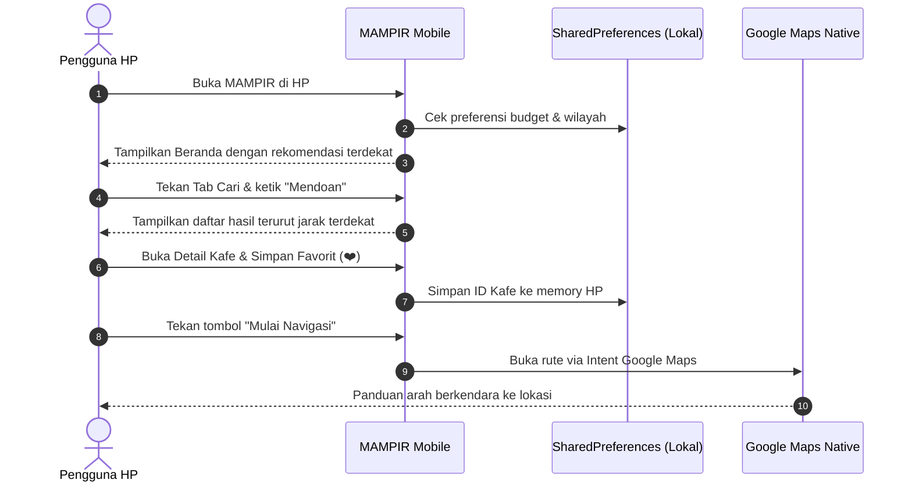
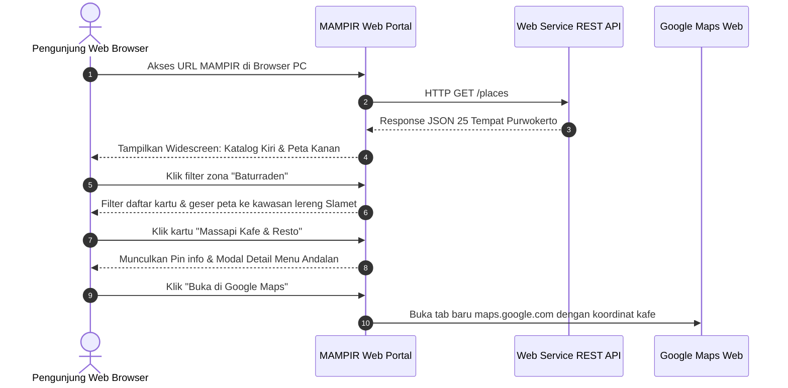

# PRODUCT REQUIREMENTS DOCUMENT (PRD)

## MAMPIR (Makan, Ampir, Pilih, dan Rekomendasi)
### Edisi Multiplatform: Mobile Application & Responsive Web Portal

**STATUS: DOKUMEN SPESIFIKASI RESMI SISTEM (FINAL)**

| | |
| --- | --- |
| **Nama Produk** | MAMPIR (Makan, Ampir, Pilih, dan Rekomendasi) |
| **Platform Target** | **Mobile App** (Android / iOS) & **Web Portal** (Responsive Web & Web Admin) |
| **Versi Dokumen** | v2.0 (Mobile & Web Full Specification) |
| **Disusun oleh** | Tim Pengembang Sistem (Pengembang) |
| **Untuk** | Pemangku Kepentingan Pariwisata & Kuliner Purwokerto (Klien & Dosen Penguji) |
| **Tanggal** | 29 Oktober 2026 |
| **Dokumen Terkait** | Kerangka Arsitektur & Spesifikasi Rekayasa Perangkat Lunak MAMPIR |

---

# 1. Ringkasan Produk (Overview)

Sektor kuliner dan tempat nongkrong di wilayah Kota Purwokerto serta kawasan penyangganya (Baturraden, Sokaraja, kawasan kampus Universitas Jenderal Soedirman / Unsoed, dan Universitas Muhammadiyah Purwokerto / UMP) menyajikan ratusan variasi destinasi kuliner, mulai dari warung makan prasmanan mahasiswa, sentra soto legendaris, kafe modern bernuansa persawahan, hingga resto alam pegunungan di lereng Gunung Slamet. Namun, akses informasi yang beredar di masyarakat saat ini masih terfragmentasi dan memiliki kesenjangan media:
1. **Pengguna Bergerak di Lapangan (*On-the-go* / Mobile):** Mahasiswa dan pelancong yang sedang berada di jalan membutuhkan akses cepat melalui ponsel pintar untuk memfilter tempat makan sesuai sisa anggaran di dompet (*budget constraint*), mengecek fasilitas (ketersediaan WiFi & colokan nugas), serta memperoleh petunjuk arah navigasi instan.
2. **Pengguna Peramban Komputer (*Pre-trip Planning & Management* / Web):** Wisatawan keluarga yang merencanakan perjalanan dari laptop atau pengelola/pemilik usaha kuliner memerlukan tampilan layar lebar (*widescreen*) untuk membandingkan puluhan tempat sekaligus berdampingan dengan peta interaktif besar, serta panel dasbor untuk mengelola data menu dan memantau statistik kuliner tanpa harus memasang aplikasi di ponsel.

**MAMPIR (Makan, Ampir, Pilih, dan Rekomendasi)** dikembangkan sebagai sistem rekomendasi dan eksplorasi kuliner terpadu berbasis **Lintas Platform (*Cross-Platform Single Codebase*)** yang mencakup:
- **Aplikasi Mobile (Android/iOS):** Berorientasi pada kenyamanan navigasi satu tangan (*one-handed UX*), kecepatan filter budget, penyimpanan tempat favorit offline tanpa login, dan integrasi penunjuk arah langsung ke Google Maps.
- **Web Portal Responsif (Desktop & Mobile Browser):** Berorientasi pada eksplorasi multi-kolom (*side-by-side list & map view*), pencarian layar lebar, serta Dasbor Pengelola (Web Admin) untuk pemutakhiran data master kuliner Purwokerto dan pemantauan koneksi Web Service.

MAMPIR berfokus murni pada penyediaan panduan informasi, kurasi menu, dan rekomendasi berbasis kecocokan anggaran secara transparan, tanpa memfasilitasi transaksi finansial komersial maupun pemesanan makanan.

---

# 2. Tujuan & Sasaran (Goals)

- **Solusi Lintas Perangkat Sejati (*True Multiplatform Accessibility*):** Memastikan ekosistem MAMPIR dapat diakses tanpa hambatan, baik melalui aplikasi native di smartphone Android maupun melalui peramban web modern (Google Chrome, Microsoft Edge, Mozilla Firefox, Safari) di komputer jinjing/desktop tanpa perlu instalasi tambahan.
- **Rekomendasi Cerdas Sadar Anggaran (*Budget-Aware Recommendation*):** Menghadirkan algoritma rekomendasi hibrida yang menyeimbangkan antara batas dana pengguna (*budget matching*), preferensi fasilitas (WiFi, colokan, outdoor, AC), dan zona wilayah di Purwokerto.
- **Pengalaman Tanpa Friksi (*Frictionless Experience*):** Memberikan akses penuh bagi pengunjung mobile dan web publik untuk mencari dan menyimpan tempat favorit secara instan tanpa kewajiban registrasi atau login akun (*local storage sandbox*).
- **Efisiensi Navigasi & Pemetaan:** Menyajikan peta interaktif OpenStreetMap yang bebas lisensi berbayar pada kedua platform, serta bridging navigasi langsung ke Google Maps native (mobile) atau Google Maps web (browser).
- **Efisiensi Manajemen Konten (Web Back-Office):** Menyediakan portal web bagi administrator dan pengelola untuk melakukan operasi CRUD (*Create, Read, Update, Delete*) data kuliner dan memantau status REST API secara visual.

---

# 3. Pengguna & Peran (Users & Roles)

```
┌─────────────────────────────────────────────────────────────────────────────┐
│                       EKOSISTEM PENGGUNA MAMPIR                             │
├───────────────────────────────┬─────────────────────────────────────────────┤
│      VERSI MOBILE (HP)        │               VERSI WEB (BROWSER)           │
├───────────────────────────────┼──────────────────────┬──────────────────────┤
│ Wisatawan & Mahasiswa         │ Pengunjung Web       │ Administrator &      │
│ (Pengguna On-The-Go)          │ Publik (Desktop/PC)  │ Pengelola Sistem     │
│ • Filter budget cepat         │ • Eksplorasi layar   │ • Kelola master data │
│ • Simpan favorit lokal di HP  │   lebar (Split-view) │   kuliner (CRUD)     │
│ • Buka navigasi Google Maps   │ • Akses instan tanpa │ • Pantau statistik & │
│ • Navigasi rute ke lokasi     │   perlu install app  │   koneksi REST API   │
└───────────────────────────────┴──────────────────────┴──────────────────────┘
```

### 3.1 Wisatawan & Mahasiswa (Pengguna Mobile)
Pengguna yang mengoperasikan aplikasi melalui smartphone saat mencari tempat makan/nongkrong secara langsung di jalan. Memanfaatkan gestur sentuh, modal sheet, filter budget cepat, bookmark favorit lokal di perangkat, dan tombol pembuka navigasi ke aplikasi Google Maps.

### 3.2 Pengunjung Web Publik (Pengguna Web Desktop / Laptop)
Pengguna yang membuka portal MAMPIR melalui browser komputer untuk merencanakan agenda makan atau rapat santai. Menikmati tata letak multi-kolom (*widescreen*): daftar kartu kuliner di sisi kiri dan peta OpenStreetMap ukuran besar di sisi kanan secara berdampingan tanpa perlu berpindah-pindah tab.

### 3.3 Administrator & Pengelola Sistem (Pengguna Web Admin)
Pengelola internal pariwisata kuliner yang menggunakan antarmuka web dasbor untuk memantau ringkasan metrik (total tempat terdata, rata-rata budget, sebaran per zona), mengelola katalog master data tempat (tambah, edit jam buka/harga menu, hapus tempat tutup), dan mengecek status respons Web Service REST API.

---

# 4. Ruang Lingkup & Matriks Fitur (Scope)

## 4.1 Ruang Lingkup Versi Mobile (MVP Mobile)
- Layar Splash animasi dan Onboarding Preferensi Awal (Wilayah, Budget, Fasilitas).
- Beranda dengan Bottom Navigation Bar (Beranda, Cari, Favorit, Peta).
- Rekomendasi Cerdas Hibrida dengan lencana alasan (*reason badges*).
- Filter Cepat Kategori & Dropdown 7 Zona Purwokerto & Sekitarnya.
- Modal Filter Anggaran (*Budget Filter Modal Sheet*).
- Tab Pencarian dengan Riwayat Pencarian Lokal (*Search History Chips*).
- Halaman Detail Tempat dengan Galeri Foto, Jam Buka, Fasilitas, dan Menu Andalan.
- Halaman Rute Polyline & Tombol Navigasi Deep-Link Google Maps.
- Tab Tempat Favorit tersimpan di memori lokal HP via `SharedPreferences`.

## 4.2 Ruang Lingkup Versi Web (MVP Web)
- Antarmuka Responsif Adaptif (*Fluid Responsive Layout*) dengan Sidebar Navigasi Kiri.
- Tampilan Eksplorasi Layar Lebar: Daftar Tempat Kuliner berdampingan langsung dengan Peta Interaktif (*Split-Pane View*).
- Pencarian Global & Filter Bar horizontal di bagian atas layar desktop.
- Modal Dialog Detail Tempat dan Rute Web ke Google Maps URL.
- Penyimpanan preferensi & bookmark berbasis Web LocalStorage.
- **Web Admin Dashboard:**
  - Kartu Ringkasan Metrik (Total Tempat, Rata-rata Budget, Rating Rata-rata, Sebaran Zona).
  - Tabel Master Data Tempat Interaktif lengkap dengan tombol Aksi (Lihat, Edit, Hapus).
  - Modal Form Tambah & Edit Tempat Kuliner dengan validasi koordinat GPS.
  - Panel Developer Tools untuk memeriksa status REST API (Online / Offline Fallback).

## 4.3 Matriks Komparasi Fitur: Mobile vs Web

| **Modul / Fungsionalitas** | **Implementasi Versi Mobile** | **Implementasi Versi Web** |
|---|---|---|
| **Navigasi Utama** | *Bottom Navigation Bar* (4 Tab utama) | *Sidebar Navigation Drawer* di kiri / *Top App Bar* |
| **Penyajian Peta & Daftar** | Terpisah: Tab Beranda (List) dan Tab Peta (Peta Fullscreen) | Terpadu: *Split-Screen* (Daftar kartu di kiri, Peta Live di kanan) |
| **Filter Anggaran** | *Modal Bottom Sheet* (geser ke atas dari bawah) | *Dropdown Panel / Filter Header Bar* di bagian atas |
| **Navigasi Rute** | Buka rute via *Intent / Deep-link* ke aplikasi Google Maps HP | Buka tautan tab baru ke `maps.google.com` via browser |
| **Penyimpanan Lokal** | Native Android/iOS `SharedPreferences` (Sandbox HP) | Peramban Web `LocalStorage / IndexedDB` via Web Storage API |
| **Dasbor Admin & Metrik** | Mode mini status pada menu Pengaturan | Dasbor Analitik layar penuh lengkap dengan tabel CRUD |
| **Interaksi Input** | Sentuhan jari (*Touch, Swipe, Tap*) | Tetikus (*Mouse Hover, Click, Scroll Wheel*) & Papan Ketik |

## 4.4 Di Luar Lingkup (Fase Lanjutan / Non-Komersial)
- Pengajuan/tambah tempat kuliner baru oleh pengguna publik ditiadakan secara permanen; seluruh data tempat dikurasi secara terpusat oleh pengelola guna menjaga keaslian dan validitas informasi (*curated catalog*).
- Transaksi pemesanan makanan (*online ordering*) dan layanan pesan-antar (*food delivery*).
- Gerbang pembayaran elektronik (*payment gateway*) dan dompet digital (*e-wallet*).
- Reservasi meja makan secara daring.

---

# 5. Asumsi & Batasan Sistem (Assumptions & Constraints)

- **Batasan Non-Finansial:** Sistem MAMPIR secara tegas tidak memproses transaksi pembayaran maupun biaya pemesanan dalam bentuk apa pun.
- **Kerangka Kerja Single Codebase Multiplatform:** Sistem dibangun menggunakan Flutter 3.x dan Dart 3.x yang mendukung kompilasi multi-target ke Android APK/AAB dan Web Bundle (HTML5, CanvasKit/WebAssembly).
- **Cakupan Geografis Khusus Purwokerto:** Data tempat kuliner dibatasi pada 7 zona: *Purwokerto Kota, Baturraden, Purwokerto Utara (Unsoed), Sokaraja, Purwokerto Timur & Sumbang, Purwokerto Barat & Selatan, dan Semua Wilayah*.
- **Breakpoint Responsivitas Layar:**
  - *Mobile Viewport:* Lebar layar `< 768px` (tata letak 1 kolom, bottom bar aktif).
  - *Tablet Viewport:* Lebar layar `768px - 1024px` (tata letak grid 2 kolom).
  - *Desktop/Web Viewport:* Lebar layar `> 1024px` (tata letak multi-kolom split-pane dengan sidebar aktif).
- **Arsitektur Data Online-First dengan Offline Fallback:** Sistem memprioritaskan pemanggilan Web Service REST API. Jika jaringan offline atau API tidak terkonfigurasi, sistem otomatis menggunakan 25 data tempat autentik lokal tanpa mengalami crash pada mobile maupun web.

---

# 6. Kebutuhan Fungsional (Functional Requirements)

## 6.1 Preferensi Pengguna & Onboarding (Mobile & Web)

| **ID** | **Kebutuhan Fungsional** | **Platform** | **Prioritas** |
| --- | --- | --- | --- |
| **PREF-1** | Menampilkan layar Splash animasi logo MAMPIR dan mendeteksi status pertama kali buka (*first launch*). | Mobile & Web | **Wajib** |
| **PREF-2** | Menampilkan alur Onboarding untuk memilih zona wilayah Purwokerto, batas budget maksimal (Rp), dan fasilitas favorit. | Mobile & Web | **Wajib** |
| **PREF-3** | Menyimpan data preferensi awal ke penyimpanan lokal (`SharedPreferences` di Mobile, `LocalStorage` di Web). | Mobile & Web | **Wajib** |
| **PREF-4** | Pada Versi Web, Onboarding dapat dilewati (*skip to explore*) agar pengunjung web dapat langsung menelusuri katalog tanpa hambatan. | Khusus Web | **Penting** |

## 6.2 Eksplorasi & Rekomendasi Cerdas (Mobile & Web)

| **ID** | **Kebutuhan Fungsional** | **Platform** | **Prioritas** |
| --- | --- | --- | --- |
| **RECM-1** | Menjalankan algoritma rekomendasi hibrida berbasis skor budget (0-35), kemiripan fasilitas (0-45), dan rating (0-20). | Mobile & Web | **Wajib** |
| **RECM-2** | Menampilkan tempat rekomendasi utama (*Featured Place Card*) yang paling pas dengan kriteria pengguna. | Mobile & Web | **Wajib** |
| **RECM-3** | Menampilkan lencana alasan rekomendasi dinamis (*reason badges*) seperti *"Pas di kantong (Rp 25k) • Rating 4.8"*. | Mobile & Web | **Wajib** |
| **RECM-4** | Menyediakan filter dropdown 7 zona Purwokerto dan filter kategori (Makan, Nongkrong, Cafe, Restoran, Warung). | Mobile & Web | **Wajib** |
| **RECM-5** | Pada Versi Web, menampilkan tempat rekomendasi dalam format Grid Responsif (3 sampai 4 kartu per baris). | Khusus Web | **Wajib** |

## 6.3 Pencarian & Riwayat (Mobile & Web)

| **ID** | **Kebutuhan Fungsional** | **Platform** | **Prioritas** |
| --- | --- | --- | --- |
| **SRCH-1** | Pengguna dapat mencari tempat kuliner dengan mengetikkan nama kafe, menu, atau suasana pada search bar. | Mobile & Web | **Wajib** |
| **SRCH-2** | Sistem mencatat riwayat pencarian terakhir (maksimal 10 entri tanpa duplikasi) dan menyediakannya dalam bentuk chips interaktif. | Mobile & Web | **Wajib** |
| **SRCH-3** | Pengguna dapat menghapus riwayat pencarian satuan atau mengosongkan seluruh riwayat secara sekaligus. | Mobile & Web | **Penting** |
| **SRCH-4** | Menyediakan filter modal (Mobile) atau popover filter (Web) untuk menyesuaikan budget, kategori, dan fasilitas. | Mobile & Web | **Wajib** |
| **SRCH-5** | Pengurutan hasil pencarian berdasarkan Jarak Terdekat (*Haversine Formula* dari Alun-Alun Purwokerto) atau Rating Tertinggi. | Mobile & Web | **Penting** |

## 6.4 Detail Tempat & Menu Andalan (Mobile & Web)

| **ID** | **Kebutuhan Fungsional** | **Platform** | **Prioritas** |
| --- | --- | --- | --- |
| **DEST-1** | Menampilkan profil lengkap tempat kuliner: foto resolusi tinggi, nama, zona, alamat, jam operasional, rating, dan fasilitas. | Mobile & Web | **Wajib** |
| **DEST-2** | Menyajikan daftar menu andalan (*signature dishes*) beserta harga satuan dalam format mata uang Rupiah. | Mobile & Web | **Wajib** |
| **DEST-3** | Menghitung dan menampilkan estimasi jarak tempuh tempat dari titik pusat Alun-Alun Purwokerto. | Mobile & Web | **Penting** |
| **DEST-4** | Pada Versi Web, detail tempat dapat dibuka dalam format Modal Dialog lebar atau Side-Panel tanpa meninggalkan peta utama. | Khusus Web | **Penting** |

## 6.5 Peta Interaktif & Navigasi Rute (Mobile & Web)

| **ID** | **Kebutuhan Fungsional** | **Platform** | **Prioritas** |
| --- | --- | --- | --- |
| **MAPS-1** | Menampilkan peta OpenStreetMap interaktif yang terpusat di poros Purwokerto–Baturraden (`LatLng(-7.3850, 109.2380)`, zoom 12.0). | Mobile & Web | **Wajib** |
| **MAPS-2** | Menampilkan marker pin seluruh tempat kuliner yang dapat diklik untuk memunculkan kartu pratinjau (*preview card*). | Mobile & Web | **Wajib** |
| **MAPS-3** | Pada Versi Mobile, menyediakan layar rute polyline terpisah dari lokasi simulasi pengguna ke tempat tujuan. | Khusus Mobile | **Wajib** |
| **MAPS-4** | Pada Versi Web, peta selalu aktif berdampingan dengan daftar tempat (*Live Map Split-Pane*). Klik pada kartu otomatis menggeser fokus peta (*re-center*). | Khusus Web | **Wajib** |
| **MAPS-5** | Menyediakan tombol navigasi rute: membuka aplikasi Google Maps native pada Mobile, atau membuka tautan tab baru Google Maps Web pada peramban. | Mobile & Web | **Wajib** |

## 6.6 Tempat Favorit (Bookmarks Offline)

| **ID** | **Kebutuhan Fungsional** | **Platform** | **Prioritas** |
| --- | --- | --- | --- |
| **FAV-1** | Pengguna dapat menandai tempat sebagai favorit menggunakan tombol ikon hati (❤️) tanpa perlu login akun. | Mobile & Web | **Wajib** |
| **FAV-2** | Menyimpan ID tempat favorit ke memori lokal secara instan (`SharedPreferences` di Mobile, `LocalStorage` di Web). | Mobile & Web | **Wajib** |
| **FAV-3** | Menampilkan koleksi tempat favorit di Tab/Halaman Favorit lengkap dengan filter kategori tempat yang disimpan. | Mobile & Web | **Wajib** |

## 6.7 Dasbor Administrator & Manajemen Data (Khusus Web Desktop)

| **ID** | **Kebutuhan Fungsional** | **Platform** | **Prioritas** |
| --- | --- | --- | --- |
| **WADM-1** | Menampilkan Dasbor Statistik Kuliner Purwokerto (Total Tempat, Rata-rata Budget, Rating Rata-rata, dan Sebaran Zona). | Khusus Web | **Wajib** |
| **WADM-2** | Menampilkan Tabel Master Data Tempat Kuliner dengan fitur pencarian teks instan dan filter dropdown per zona wilayah. | Khusus Web | **Wajib** |
| **WADM-3** | Menyediakan fitur Tambah Data Tempat langsung dari web admin dengan validasi koordinat latitude/longitude. | Khusus Web | **Wajib** |
| **WADM-4** | Menyediakan fitur Edit Data Tempat untuk mengubah harga menu, jam operasional, atau foto tempat. | Khusus Web | **Wajib** |
| **WADM-5** | Menyediakan fitur Hapus Data Tempat yang sudah tutup/nonaktif dengan konfirmasi dialog pencegahan salah hapus. | Khusus Web | **Wajib** |
| **WADM-6** | Menyediakan panel Developer Tools untuk memantau status kesehatan REST API (Online / Offline Fallback) dan sinkronisasi data. | Khusus Web | **Penting** |

---

# 7. Perancangan Tata Letak & UX (Mobile vs Web Layout)

```
========================================================================================
LAYOUT VERSI MOBILE (Lebar < 768px)           LAYOUT VERSI WEB DESKTOP (Lebar > 1024px)
========================================================================================

┌─────────────────────────────────┐   ┌──────────────────────────────────────────────────────────────┐
│ [📍 Purwokerto Kota  ▼]     [🔔]│   │ MAMPIR PURWOKERTO   [🔍 Cari Kafe...] [Zona ▼]   [Admin Panel]│
│ ┌─────────────────────────────┐ │   ├────────────┬─────────────────────────────┬───────────────────┤
│ │ 🔍 Cari tempat atau budget.. │ │   │ [SIDEBAR]  │ [KATALOG REKOMENDASI]       │ [PETA LIVE OSM]   │
│ └─────────────────────────────┘ │   │ • Beranda  │ ┌─────────────────────────┐ │ ┌───────────────┐ │
│ [Makan] [Nongkrong] [Cafe]      │   │ • Cari     │ │ Kopi Keprok Baturraden │ │ │ Peta Besar     │ │
│                                 │   │ • Favorit  │ │ ⭐ 4.8 • Rp 25.000      │ │ │ Wilayah       │ │
│ --- REKOMENDASI UNTUK KAMU ---  │   │ • Peta Pwt │ └─────────────────────────┘ │ │ Purwokerto &    │ │
│ ┌─────────────────────────────┐ │   │ • Tambah   │ ┌─────────────────────────┐ │ │ Baturraden     │ │
│ │ Kopi Keprok Baturraden      │ │   │ • Admin    │ │ Soto H. Loso Sokaraja   │ │ │               │ │
│ │ Rp 25.000 • ⭐ 4.8          │ │   │            │ │ ⭐ 4.9 • Rp 30.000      │ │ │  [● Pin Pwt]  │ │
│ └─────────────────────────────┘ │   │            │ └─────────────────────────┘ │ │  [● Pin Btr]  │ │
│                                 │   │            │ ┌─────────────────────────┐ │ │               │ │
│ --- TEMPAT POPULER ---          │   │            │ │ Table Nine Kitchen      │ │ └───────────────┘ │
│ [Card 1] [Card 2]               │   │            │ │ ⭐ 4.8 • Rp 60.000      │ │ Klik kartu ->   │
│ ─────────────────────────────── │   │            │ └─────────────────────────┘ │ Peta otomatis geser│
│ [🏠 Home] [🔍 Cari] [❤️ Fav] [🗺️]│   ├────────────┴─────────────────────────────┴───────────────────┤
└─────────────────────────────────┘   │ Status: Web Service REST API Terhubung (25 Tempat Aktif)     │
                                      └──────────────────────────────────────────────────────────────┘
```

### 7.1 Karakteristik UX Versi Mobile
- **Navigasi Satu Tangan:** Seluruh menu utama berada pada *Bottom Navigation Bar* yang mudah dijangkau ibu jari.
- **Transisi Halus:** Perpindahan halaman menggunakan animasi slide & fade vertikal yang natural.
- **Penyajian Data Vertikal:** Kartu kuliner disusun bertingkat ke bawah (*vertical scroll*) dan kartu populer disusun mendatar (*horizontal carousel*).

### 7.2 Karakteristik UX Versi Web Desktop
- **Pemanfaatan Widescreen (Multi-Pane):** Layar dibagi menjadi 3 bagian: Sidebar Navigasi Kiri (lebar 240px), Kolom Daftar Rekomendasi Tengah (lebar fleksibel ~55%), dan Kolom Peta Interaktif Kanan (lebar ~45%).
- **Interaksi Tanpa Pindah Halaman:** Pengguna tidak perlu keluar masuk tab untuk melihat peta. Mengklik kartu kuliner di tengah akan otomatis menggerakkan fokus peta di sebelah kanan (*instant re-centering*).
- **Efisiensi Tetikus & Papan Ketik:** Dilengkapi efek hover visual pada kartu, tooltip informasi, dan input teks langsung pada search bar global tanpa harus membuka tab pencarian terpisah.

---

# 8. Alur Pengguna Utama (Key User Flows)

## 8.1 Alur Pengguna Mobile: Pencarian On-The-Go & Navigasi



## 8.2 Alur Pengguna Web Publik: Eksplorasi Layar Lebar Terpadu



## 8.3 Alur Administrator Web: Manajemen Data Master Kuliner

1. Administrator mengakses rute `/admin` pada peramban web desktop.
2. Dasbor menyajikan ringkasan metrik: 25 tempat aktif, rata-rata budget Rp 25.400, dan sebaran per 7 zona wilayah.
3. Administrator memilih menu "Kelola Data Tempat".
4. Administrator menekan tombol "+ Tambah Tempat Kuliner Baru".
5. Administrator mengisi formulir web: nama tempat, memilih zona wilayah (misal: "Purwokerto Utara (Unsoed)"), kategori, jam buka, checklist fasilitas, dan koordinat GPS.
6. Administrator menambahkan item menu andalan dan harganya, lalu menekan tombol "Simpan Data".
7. Sistem memvalidasi input dan mengirimkan HTTP POST ke endpoint REST API.
8. Tabel data di web secara otomatis diperbarui dan data baru langsung tersinkronisasi ke katalog publik.

---

# 9. Model Data & Skema Penyimpanan (High-Level)

| **Entitas / Field** | **Tipe Data** | **Penyimpanan Mobile** | **Penyimpanan Web** | **Keterangan** |
|---|---|---|---|---|
| **places.id** | String | Memori Klien / SharedPreferences | Web Storage / REST API | ID unik tempat (contoh: `pwt-1`, `btr-1`). |
| **places.name** | String | Objek `PlaceModel` | Objek `PlaceModel` | Nama tempat kuliner / kafe / warung. |
| **places.city** | String | Objek `PlaceModel` | Objek `PlaceModel` | Zona wilayah (7 zona Purwokerto). |
| **places.category** | String | Objek `PlaceModel` | Objek `PlaceModel` | Kategori (Makan, Nongkrong, Cafe, Resto). |
| **places.avg_price** | Integer | Objek `PlaceModel` | Objek `PlaceModel` | Estimasi pengeluaran rata-rata per orang. |
| **places.rating** | Double | Objek `PlaceModel` | Objek `PlaceModel` | Skor rating ulasan (1.0 s/d 5.0). |
| **places.facilities** | List\<String\>| Objek `PlaceModel` | Objek `PlaceModel` | Tag fasilitas (WiFi, Colokan, Outdoor, AC). |
| **places.latitude** | Double | Objek `PlaceModel` | Objek `PlaceModel` | Garis lintang GPS (-7.31 s/d -7.46). |
| **places.longitude** | Double | Objek `PlaceModel` | Objek `PlaceModel` | Garis bujur GPS (109.21 s/d 109.28). |
| **places.menu_highlights** | List\<JSON\> | Objek `PlaceModel` | Objek `PlaceModel` | Relasi daftar menu andalan dan harganya. |
| **user_budget** | Integer | `SharedPreferences` (Key: `user_budget`) | `LocalStorage` (Key: `user_budget`) | Batas dana acuan pengguna. |
| **selected_region** | String | `SharedPreferences` (Key: `selected_region`) | `LocalStorage` (Key: `selected_region`) | Zona pilihan utama pengguna. |
| **search_history** | List\<String\>| `SharedPreferences` (Key: `search_history`) | `LocalStorage` (Key: `search_history`) | Riwayat kata kunci pencarian (maks 10). |
| **favorite_places** | List\<String\>| `SharedPreferences` (Key: `favorite_places`) | `LocalStorage` (Key: `favorite_places`) | Kumpulan ID tempat yang disimpan favorit. |

---

# 10. Kebutuhan Non-Fungsional (Non-Functional Requirements)

- **Kinerja Multiplatform (Cross-Platform Performance):**
  - Pada perangkat Mobile: Waktu rendering antarmuka stabil pada 60 fps, startup time aplikasi di bawah 2 detik.
  - Pada peramban Web: Ukuran initial bundle awal dioptimalkan dengan teknik *deferred loading*, waktu First Contentful Paint (FCP) di bawah 1,8 detik pada jaringan 4G standar.
- **Kompatibilitas Peramban Web (Browser Compatibility):** Web portal harus berfungsi sempurna pada Google Chrome versi 100+, Microsoft Edge versi 100+, Mozilla Firefox versi 100+, dan Safari macOS/iOS 15+ tanpa distorsi layout maupun error JavaScript.
- **Keandalan & Ketahanan (High Resilience / Offline Fallback):** Baik versi mobile maupun web dilengkapi mekanisme penanganan kegagalan otomatis. Jika koneksi backend REST API terputus, aplikasi tidak akan crash, melainkan menyajikan 25 tempat autentik Purwokerto secara lokal.
- **Keamanan & Isolasi Data Lokal:** Data preferensi budget dan bookmark favorit pada versi mobile tersimpan di sandbox internal aplikasi, sedangkan pada versi web tersimpan di LocalStorage domain terisolasi.
- **Estetika & Ergonomi Visual:** Menggunakan palet tema gelap elegan khas MAMPIR (*Deep Navy* `#0D1326`, *Surface Navy* `#161F38`, aksen emas *Amber Gold* `#F5A623`, dan *Vibrant Orange* `#E65100`) dengan standar kontras keterbacaan tinggi (WCAG AA).

---

# 11. Integrasi Pihak Ketiga & Arsitektur Sistem

| **Komponen / Layanan** | **Fungsi pada Versi Mobile** | **Fungsi pada Versi Web** |
|---|---|---|
| **OpenStreetMap & `flutter_map`** | Render tile peta interaktif & marker pin pada layar HP | Render tile peta interaktif ukuran penuh pada kolom kanan layar web |
| **Google Maps & `url_launcher`** | Membuka aplikasi Google Maps via Android Intent / iOS URL Scheme | Membuka tab baru browser menuju `https://www.google.com/maps/search/?api=1&query=lat,lng` |
| **Supabase / REST Web Service** | Memanggil API via package `http` (HTTP GET /places & POST /places) | Memanggil API via package `http` dengan dukungan Cross-Origin Resource Sharing (CORS) |
| **Persistent Storage Engine** | Native Android Shared Preferences / iOS NSUserDefaults | Browser Web Storage API (`window.localStorage` / `IndexedDB`) |

---

# 12. Fitur Usulan / Fase Lanjutan

- **Sinkronisasi Akun Cloud Lintas Platform (Cloud Sync):** Autentikasi opsional (Google Sign-In) untuk menyinkronkan tempat favorit yang disimpan di HP agar otomatis muncul saat pengguna membuka portal MAMPIR di laptop.
- **Ekspor Data Laporan Kuliner (Web Admin Export):** Kemampuan mengunduh data master kuliner dan rekapitulasi rating ke dalam format CSV / Excel dari panel web admin.
- **Smart Mood & Group Budget Splitter:** Fitur pencocokan suasana hati dan kalkulator pembagian patungan makan rombongan untuk mahasiswa.
- **Validasi Ulasan Berbasis Geolokasi (GPS Check-In):** Verifikasi ulasan komunitas untuk memastikan pengulas pernah berada dalam radius 100 meter dari tempat kuliner.

---

# 13. Pertanyaan Terbuka / TBD (To Be Decided)

- Konfigurasi domain produksi dan aktivasi header Cross-Origin Resource Sharing (CORS) pada backend REST API untuk akses web hosting publik.
- Kebijakan penerimaan data tempat baru dari publik: apakah langsung dipublikasikan atau memerlukan status persetujuan (*approval pending*) oleh Administrator pada web dasbor.
- Pengaturan kompresi WebP untuk galeri foto agar kecepatan muat gambar pada peramban web tetap maksimal.

---

# 14. Glosarium

- **Cross-Platform Single Codebase :** Paradigma rekayasa perangkat lunak di mana satu proyek kode program Flutter (Dart) dapat dibangun dan dikompilasi menjadi aplikasi native smartphone (Android/iOS) dan aplikasi web (HTML5/CanvasKit).
- **Split-Pane View :** Pola tata letak antarmuka layar lebar di mana daftar konten dan peta interaktif ditampilkan secara berdampingan dalam satu layar tanpa perlu saling menimpa.
- **Responsive Breakpoint :** Batas ukuran lebar layar (resolusi pixel) yang menjadi titik pemicu perubahan tata letak antarmuka dari mode mobile ke mode desktop.
- **Offline Fallback :** Mekanisme pengalihan otomatis ke basis data lokal jika koneksi ke server pusat (*remote API*) terputus, mencegah terjadinya galat fatal pada aplikasi.
- **Haversine Formula :** Algoritma perhitungan trigonometri sferis untuk menghitung jarak garis lurus terpendek antara dua koordinat geografis di bumi.
- **LocalStorage :** Mekanisme penyimpanan data berbasis peramban web yang memungkinkan data tetap tersimpan meskipun jendela browser ditutup.

---

*Dokumen ini merupakan spesifikasi kebutuhan resmi aplikasi MAMPIR Multiplatform (Mobile & Web) dan menjadi acuan utama dalam pengembangan, pengujian, serta demonstrasi sistem.*
